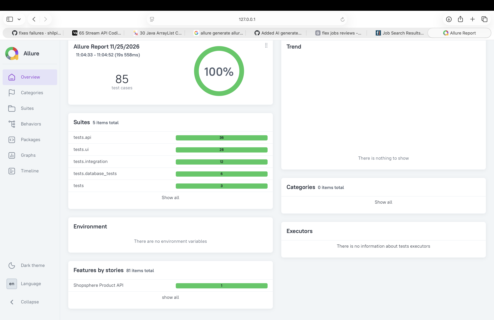
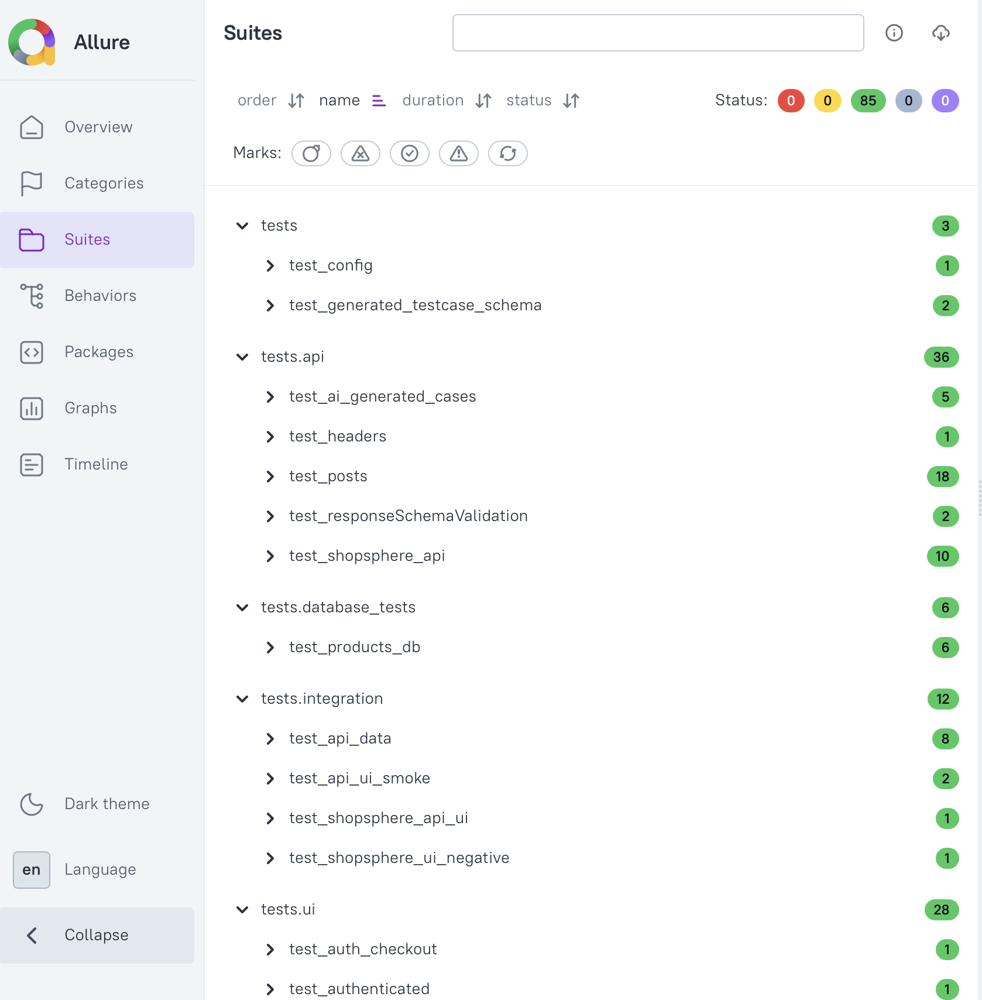

# ShopSphere – AI-Assisted API & UI Test Automation Framework

[
[

## Project Overview

ShopSphere is an end-to-end API and UI test automation framework built using Python, Pytest, Requests and Playwright.

The framework combines traditional test automation with AI-assisted test case generation using the OpenAI API. It generates structured test scenarios from API requirements, validates them using JSON Schema and semantic validation, and executes them through a data-driven Pytest framework.

The project also demonstrates Docker-based application execution, automated test reporting using Allure and CI/CD integration through GitHub Actions.

## Key Features

- **AI-Assisted Test Generation:** Generate API test cases from requirements using OpenAI API.
- **Data-Driven API Testing:** Execute generated test cases using Pytest and Requests.
- **JSON Schema Validation:** Validate the structure of AI-generated test cases and API responses.
- **Semantic Validation:** Verify test scenario coverage, expected status codes and test classifications.
- **API Automation:** Validate positive, negative and boundary scenarios.
- **UI Automation:** Automate browser workflows using Playwright.
- **API and UI Integration:** Validate consistency between API responses and UI data.
- **Database Testing:** Validate SQLite database records and constraints.
- **Docker Integration:** Build and execute the ShopSphere API in a container.
- **Allure Reporting:** Generate detailed execution reports.
- **CI/CD Integration:** Execute automated tests through GitHub Actions.

## Technology Stack

| Category | Technologies |
|---|---|
| Programming Language | Python |
| API Automation | Pytest, Requests |
| UI Automation | Playwright |
| AI Integration | OpenAI API |
| Data Validation | JSON Schema |
| Backend | Flask |
| Database | SQLite |
| Containerization | Docker |
| Test Reporting | Allure |
| CI/CD | GitHub Actions |
| Version Control | Git, GitHub |

## Project Architecture

### AI-Assisted API Test Generation Flow

```text
API Requirements
       |
       v
OpenAI API
       |
       v
AI-Generated Test Cases
       |
       v
Structured JSON Output
       |
       v
JSON Schema Validation
       |
       v
Semantic Validation
       |
       v
Pytest Data-Driven Execution
       |
       v
ShopSphere Product API
       |
       v
API Response Validation
       |
       v
Allure Test Report
```

AI-generated test cases are stored in JSON format and reused during test execution. This separates test generation from routine CI execution.

## AI-Assisted Test Case Generation

The framework uses the OpenAI API to generate API test cases from functional requirements.

### Generation Process

1. Define API requirements.
2. Prepare the test generation prompt.
3. Send the prompt to the OpenAI API.
4. Generate structured JSON test cases.
5. Validate the generated output against JSON Schema.
6. Perform semantic validation.
7. Store validated test cases in `data/generated_test_cases.json`.
8. Execute the generated scenarios using Pytest.

### Sample Generated Test Scenarios

| Test Case | Scenario | Expected Status |
|---|---|---|
| TC001 | Retrieve existing product | 200 |
| TC002 | Retrieve non-existing product | 404 |
| TC003 | Non-integer product ID | 404 |
| TC004 | Zero product ID | 404 |
| TC005 | Negative product ID | 404 |

### AI Test Generation Benefits

- Reduces manual effort in preparing test scenarios.
- Improves coverage of positive, negative and boundary conditions.
- Produces structured and reusable test data.
- Combines AI-generated scenarios with deterministic automated validation.

## API Automation

API tests are implemented using Python, Pytest and Requests.

Key validation areas:

- HTTP status code validation.
- Response body validation.
- Response schema validation.
- Positive and negative scenarios.
- Boundary value testing.
- API response time validation.
- Request headers and API chaining.
- Data-driven API execution.

## UI Automation

Playwright is used for end-to-end browser automation.

Key coverage includes:

- User authentication.
- Login and negative login scenarios.
- Product selection.
- Shopping cart operations.
- Checkout workflows.
- UI and API data consistency.
- Error handling and UI validation.

## Database Testing

SQLite is integrated with the ShopSphere backend.

Database tests validate:

- Product records.
- Product prices and stock.
- Duplicate product ID restrictions.
- Negative price and stock validation.
- Null product name restrictions.

## Docker Integration

The ShopSphere Flask API is containerized using Docker.

The container exposes the API on host port `5001`, mapped to container port `5000`.

Example:

```bash
docker build -t shopsphere-api:1.0 .

docker run -d \
  --name shopsphere-api \
  -p 5001:5000 \
  shopsphere-api:1.0
```

Verify API health:

```bash
curl http://127.0.0.1:5001/health
```

## GitHub Actions CI/CD

The project contains two GitHub Actions workflows:

### 1. ShopSphere Automation Tests

- Checkout repository.
- Install dependencies.
- Generate SauceDemo authentication state.
- Build and start the ShopSphere Docker container.
- Execute API automation tests.
- Execute AI-generated API tests.
- Execute integration tests.
- Generate and upload Allure reports.

### 2. Playwright Tests

- Checkout repository.
- Set up Python environment.
- Install dependencies and Playwright browsers.
- Generate authentication state.
- Build and start the ShopSphere Docker container.
- Execute the complete Pytest suite.
- Upload test artifacts when execution fails or is cancelled.

AI test generation is kept separate from routine CI execution. GitHub Actions executes the committed and validated JSON test cases without requiring an OpenAI API call on every workflow run.

## Allure Reporting

Allure provides detailed test execution reports.

Generate test results:

```bash
pytest --alluredir=allure-results
```

Generate the HTML report:

```bash
allure generate allure-results -o allure-report --clean
```

Open the report:

```bash
allure open allure-report
```

The GitHub Actions workflows also generate and upload Allure report artifacts.

### Allure Report Dashboard

The following screenshot shows the automated test execution results
and test case summary.





## Project Setup

### Prerequisites

- Python
- Git
- Docker
- Playwright
- Allure
- OpenAI API key (for AI test generation)

### Clone Repository

```bash
git clone https://github.com/shilpisharmag/shopsphere-automation.git

cd shopsphere-automation
```

### Create Virtual Environment

```bash
python -m venv .venv
```

Activate on macOS/Linux:

```bash
source .venv/bin/activate
```

### Install Dependencies

```bash
pip install -r requirements.txt
pip install -r api/requirements.txt
```

### Install Playwright Browsers

```bash
python -m playwright install
```

### Configure OpenAI API Key

Set your API key as an environment variable:

```bash
export OPENAI_API_KEY="your-api-key"
```

Keep API keys and credentials out of source control.

## Test Execution

### Run AI-Generated API Tests

```bash
pytest tests/api/test_ai_generated_cases.py -v
```

### Run API Tests

```bash
pytest tests/api/ -v
```

### Run UI Tests

```bash
pytest tests/ui/ -v
```

### Run Integration Tests

```bash
pytest tests/integration/ -v
```

### Run Database Tests

```bash
pytest tests/database_tests/ -v
```

### Run Complete Test Suite

```bash
pytest -v
```

## Future Enhancements

- AI-powered test failure analysis.
- Automated test case maintenance.
- AI-assisted test data generation.
- Enhanced API coverage and negative scenario generation.
- Integration of AI-driven testing into CI/CD.
- Improved test execution analytics.

## Project Highlights

This project demonstrates the integration of AI-assisted test generation with traditional automation practices.

It brings together API testing, UI automation, database validation, Docker, structured test validation, reporting and CI/CD in a single framework.

**The objective is to explore how AI can reduce manual test design effort while maintaining reliable, repeatable and scalable test automation.**